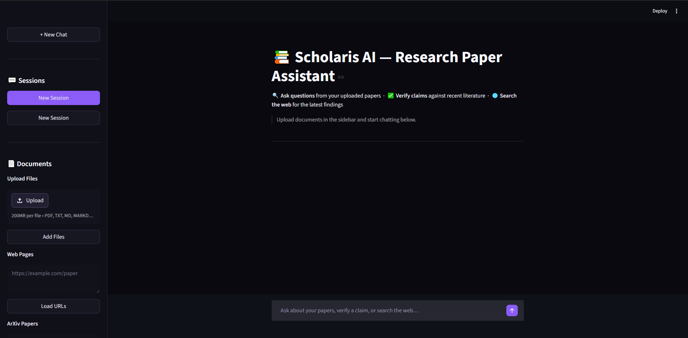

<div align="center">

# 📚 Scholaris AI — Research Paper Assistant

**A conversational, agentic RAG assistant that lets you upload, explore, and fact-check academic papers through natural-language chat.**


</div>

<p align="center">
  
</p>

---

## Overview

**Scholaris AI** is a Retrieval-Augmented Generation (RAG) application built with **LangGraph, LangChain, and Streamlit**. Users upload research papers — as PDF, TXT, Markdown, a web URL, or an ArXiv ID — into isolated sessions, then ask questions about them in plain English.

What sets it apart from a basic RAG demo is a **LangGraph state machine** that makes the system *agentic* and *self-correcting*: it **routes** each query to the right strategy, **grades whether retrieved context is actually relevant**, **rewrites the query and retries** when retrieval falls short, and can **verify whether a paper's claim has been superseded** by newer research.

### ✨ Highlights

- 🧭 **Intelligent routing** — each query is classified into *retrieve*, *verify claim*, or *direct answer*, so retrieval only runs when it adds value.
- 🔁 **Self-correcting retrieval (Corrective RAG)** — an LLM grades retrieved chunks and reformulates the query if they're not relevant, with hard caps that guarantee termination.
- 🔬 **Claim verification** — cross-checks a paper's claim against the live web **and** ArXiv, and is constrained to cite only sources that appear verbatim in results (no fabricated references).
- 🗂️ **Session isolation** — each session gets its own Qdrant collection, so papers never leak across sessions.
- ⚡ **Cached embeddings** — identical text is never re-embedded, cutting embedding API calls to near-zero.
- 📊 **Measured with DeepEval** — an automated evaluation harness scores retrieval and generation across five RAG metrics.

---

## Table of Contents

- [Features](#features)
- [Tech Stack](#tech-stack)
- [Architecture](#architecture)
- [How to Use](#how-to-use)
- [Installation](#installation)
- [Required API Keys](#required-api-keys)
- [Run with Docker](#run-with-docker)
- [Design Decisions & Why](#design-decisions--why)
- [Evaluation](#evaluation)
- [Project Structure](#project-structure)
- [License](#license)

---

## Features

| Feature | Description |
|---|---|
| **Paper Q&A** | Ask questions about uploaded papers; the system retrieves relevant chunks and generates grounded answers |
| **Claim Verification** | Ask the assistant to verify a claim — it searches the web and ArXiv to determine if the claim is current or superseded, and returns links to newer papers if applicable |
| **Web Search** | For questions about current developments, live Tavily results are incorporated |
| **Direct Answers** | Stable general-knowledge questions are answered without retrieval or web calls |
| **`/btw` Command** | A side-channel for off-topic questions. The LLM decides to answer directly or search the web. These exchanges are **not stored in session history** |
| **Multi-session UI** | Open multiple independent sessions, each with its own paper collection and conversation history |
| **Auto Session Naming** | Session titles are auto-generated (3–5 words) from the first message using the LLM |
| **Multiple Paper Sources** | Load papers via file upload (PDF, TXT, MD), web URL, or ArXiv ID/title search |
| **Graph State Inspector** | Each assistant turn exposes an expandable JSON view of the LangGraph state for debugging |
| **Streaming Responses** | Assistant responses stream token-by-token with a cursor animation |

---

## Tech Stack

| Layer | Technology |
|---|---|
| **Orchestration** | LangGraph (stateful, cyclic agent workflow) + LangChain |
| **UI** | Streamlit |
| **LLM** | Google Gemini — `gemini-3.1-flash-lite` (chat, routing, grading, generation) |
| **Embeddings** | Google Gemini — `gemini-embedding-001`, 1536-dim, cosine similarity |
| **Vector store** | Qdrant Cloud (one collection per session) |
| **Web search** | Tavily |
| **Evaluation** | DeepEval (LLM-as-judge, `gpt-5.4-mini`) |
| **Packaging / deploy** | uv · Docker |

---

## Architecture

```
app.py (Streamlit UI)
│
├── backend/rag_graph.py     — LangGraph RAG workflow (router → retrieve / verify / direct → answer)
├── backend/btw_handler.py   — Off-topic /btw handler (streaming, not stored in history)
├── backend/vector_store.py  — Qdrant Cloud vector store with cached Gemini embeddings
├── backend/paper_loader.py  — Multi-source paper loader (PDF, TXT, MD, URL, ArXiv)
└── backend/models.py        — Pydantic models for routing and structured LLM outputs
```

### RAG Graph Decision Flow

```
User Query
    │
    ▼
 Router (LLM)
    │
    ├── direct_answer ─────────────────────────────────► Generate Answer
    │
    ├── retrieve ──► Agent (vector + web tools) ──► Relevancy Check
    │                   ▲   (≤ 3 tool-call attempts)      │
    │                   └──── Query Rewrite (once) ◄───── if not relevant
    │                                                     │
    │                                        if relevant ─► Generate Answer
    │
    └── verify_claim ──► Web Search + ArXiv Search ──► Verdict + Superseding Papers
```

> A rendered graph diagram is included as [`graph.png`](graph.png).

---

## How to Use

### 1. Start a session
Launch the app and a default session is created automatically. Use **+ New Chat** in the sidebar to start additional sessions.

### 2. Upload papers
In the sidebar, choose one of three loading methods:
- **File Upload** — drag and drop a PDF, TXT, or MD file
- **Web URL** — paste one or more URLs (one per line)
- **ArXiv** — enter a paper title or ArXiv ID (e.g. `2303.08774`)

Loaded papers appear under **Loaded Documents** in the sidebar.

### 3. Ask questions
Type in the chat input. Example queries:
- *"What methodology does the paper use for evaluation?"*
- *"Verify the claim that encoder-decoder models are the best approach for translation."*
- *"What are the latest developments in diffusion models?"*

### 4. Use `/btw` for off-topic questions
Prefix any message with `/btw` to ask a question outside the current paper context. These exchanges are **not** saved to the session:
```
/btw What is the difference between RLHF and DPO?
```

---

## Installation

Scholaris AI uses [uv](https://github.com/astral-sh/uv) for dependency management.

```bash
# Clone the repository
git clone <repo-url>
cd rag-papeer-project

# Install all dependencies
uv sync

# Copy the example env file and fill in your keys
cp .env.example .env

# Run the Streamlit app
uv run streamlit run app.py
```

Add a new dependency:
```bash
uv add <package-name>
```

Run a backend module directly (useful during development):
```bash
uv run python -m backend.<module_name>
```

---

## Required API Keys

All keys are loaded from a `.env` file in the project root via `python-dotenv`. Copy `.env.example` to `.env` and fill in your values.

| Variable | Purpose | Where to Get It |
|---|---|---|
| `GOOGLE_API_KEY` | Chat LLM (`gemini-3.1-flash-lite`) **and** embeddings (`gemini-embedding-001`) — required to run the app | [aistudio.google.com](https://aistudio.google.com) |
| `TAVILY_API_KEY` | Web search for current developments and claim verification | [tavily.com](https://tavily.com) |
| `QDRANT_URL` | Qdrant Cloud endpoint for the vector store | [cloud.qdrant.io](https://cloud.qdrant.io) |
| `QDRANT_API_KEY` | Authentication for Qdrant Cloud | [cloud.qdrant.io](https://cloud.qdrant.io) |
| `OPENAI_API_KEY` | **Only** for the DeepEval evaluation judge (`gpt-5.4-mini`) — not needed to run the app | [platform.openai.com](https://platform.openai.com) |

See [`.env.example`](.env.example) for the exact variables to set — copy it to `.env` and fill in your own values.

> ⚠️ **Never commit your real `.env`.** It is git-ignored by default — keep it that way and share only `.env.example`.

---

## Run with Docker

The app is fully containerized. Keys are supplied at runtime, never baked into the image.

```bash
# Build
docker build -t scholaris-ai .

# Run (keys are read from your local .env file)
docker run -d -p 8501:8501 --env-file .env --name scholaris-ai scholaris-ai
```

Then open `http://localhost:8501`. The same image can be pushed to any container host (e.g. AWS EC2 or a free-tier platform).

---

## Design Decisions & Why

| Decision | Rationale |
|---|---|
| **Query routing** | Retrieval costs latency, tokens, and can inject noise for questions the model already knows. Routing ensures the system only retrieves when it helps. |
| **Retrieval agent capped at 3 tool-call attempts** (`MAX_RETRIEVAL_ATTEMPTS`) | Bounds the inner tool-calling loop so the agent can't call tools indefinitely. At the cap it switches to a plain (non-tool) LLM to avoid leaving an orphaned tool-call in the checkpointed history. |
| **Query rewritten at most once** (`rewrite_count < 1`) | Bounds the outer self-correction loop. If a single rewrite still fails, the system answers gracefully instead of looping forever. |
| **Chunk size 1000 / overlap 200** | ~1000 chars holds one coherent idea while staying focused; the 200-char (20%) overlap keeps sentences split across boundaries retrievable. |
| **`k = 4` default retrieval chunks** | Balances context richness against prompt length and cost (the agent may request 1–10). |
| **Embedding dimension 1536** | `gemini-embedding-001` supports Matryoshka truncation (768 / 1536 / 3072); 1536 gives strong retrieval quality at half the storage/compute of 3072. |
| **Cosine similarity** | Angle-based similarity is magnitude-invariant — the right choice for text embeddings, where direction encodes meaning. |
| **Session-scoped Qdrant collections** | Each collection is namespaced by session UUID (`papeer_{session_id}`), preventing cross-session leakage. |
| **Claim verification uses two searches** | A general web search catches blogs/news; an `arxiv.org`-targeted search catches academic superseding work. One search alone misses one source type. |
| **`/btw` exchanges not stored** | Deliberately off-topic questions would pollute the paper-focused conversation and confuse later turns, so they run in a stateless side channel. |
| **Structured (Pydantic) LLM outputs** | Routing and grading return validated schemas, so branching keys always exist and the router literally cannot return an invalid option. |

### Production optimizations

| Optimization | Details |
|---|---|
| **Embedding cache** | `CacheBackedEmbeddings` writes to `./embedding_cache/` so identical text is never re-embedded across sessions — reduces **Gemini embedding** API calls and latency |
| **Graph caching** | The LangGraph graph is built once with `@st.cache_resource` and reused across all Streamlit reruns |
| **Streaming responses** | `graph.stream(stream_mode="messages")` streams only the final answer node token-by-token, so internal router/grader output never leaks to the UI |
| **Durable memory** | A SQLite checkpointer stores full conversation state per session; `sessions.json` holds lightweight metadata — restarts restore the previous session |
| **Temp-file cleanup** | Uploaded files are written to a temp path, processed, then deleted regardless of success or failure |
| **Throttled evaluation** | The eval pipeline uses bounded concurrency (3 workers, 5 s throttle) to stay within judge-model rate limits |
| **ArXiv reliability** | Loading and verification hit the ArXiv/Tavily APIs directly with explicit timeouts instead of the `arxiv` Python library, which had reliability issues |

---

## Evaluation

An automated RAG evaluation pipeline (`evaluate.py`) built on [DeepEval](https://github.com/confident-ai/deepeval) turns "it feels right" into numbers. It auto-generates synthetic golden Q&A from a source paper, runs them through the real graph, and scores five metrics (pass threshold **0.7**).

```bash
uv run python evaluate.py
```

### Metrics

| Metric | What It Measures | Grades |
|---|---|---|
| **Contextual Precision** | Are the relevant chunks ranked above irrelevant ones? | Retrieval |
| **Contextual Recall** | Does the retrieved context cover all expected information? | Retrieval |
| **Contextual Relevancy** | What fraction of the retrieved context is on-topic? | Retrieval |
| **Answer Relevancy** | Does the generated answer address the question? | Generation |
| **Faithfulness** | Is the answer grounded in the context (no hallucination)? | Generation |

### Latest results (10 test cases)

| Metric | Avg Score | Pass |
|---|---|---|
| Contextual Precision | **0.98** | 10/10 |
| Contextual Recall | **1.00** | 10/10 |
| Answer Relevancy | **0.99** | 10/10 |
| Faithfulness | **0.98** | 10/10 |
| Contextual Relevancy | 0.58 | 5/10 |

Retrieval **recall** and answer **faithfulness** are near-perfect — the right information is consistently retrieved and answers stay grounded. The lower **Contextual Relevancy** reflects retrieving `k=4` chunks without re-ranking, so some loosely-related context is included; the planned fix is a re-ranking step that fetches more candidates and keeps only the most relevant.

- On first run, synthetic goldens are generated from `documents/Openclaw_Research_Report.pdf` and cached to `goldens.json`.
- Results are written to `eval_results.json` with per-test scores, pass/fail, and reasons.
- Subsequent runs reuse cached goldens unless `goldens.json` is deleted.

---

## Project Structure

```
rag-papeer-project/
├── app.py                 # Streamlit UI, sessions, streaming, uploads
├── evaluate.py            # DeepEval evaluation pipeline
├── backend/
│   ├── rag_graph.py       # LangGraph workflow (the core)
│   ├── vector_store.py    # Qdrant + cached Gemini embeddings
│   ├── paper_loader.py    # PDF / TXT / MD / URL / ArXiv loaders + chunking
│   ├── btw_handler.py     # /btw side channel
│   └── models.py          # Pydantic structured-output schemas
├── documents/             # Sample paper used for evaluation
├── assets/                # Screenshots used in this README
├── goldens.json           # Cached synthetic eval questions
├── eval_results.json      # Latest evaluation results
├── Dockerfile             # Container build
├── requirements.txt       # Pinned dependencies
├── pyproject.toml         # Project + uv dependencies
└── .env.example           # Template for required API keys
```

---

## License

Released under the **MIT License**. Add a `LICENSE` file to the repository root to make it official.

---

<div align="center">
<sub>Built with LangGraph, Qdrant, and Google Gemini · routes intelligently, corrects its own retrieval, and is measured end-to-end.</sub>
</div>
